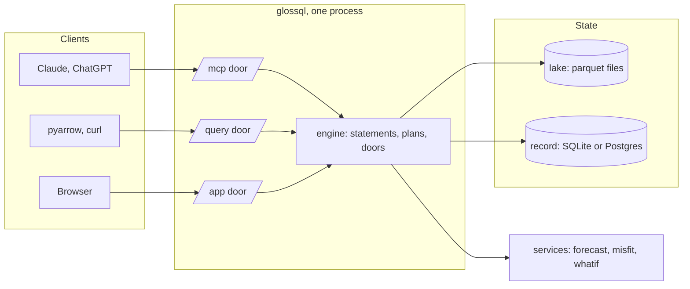
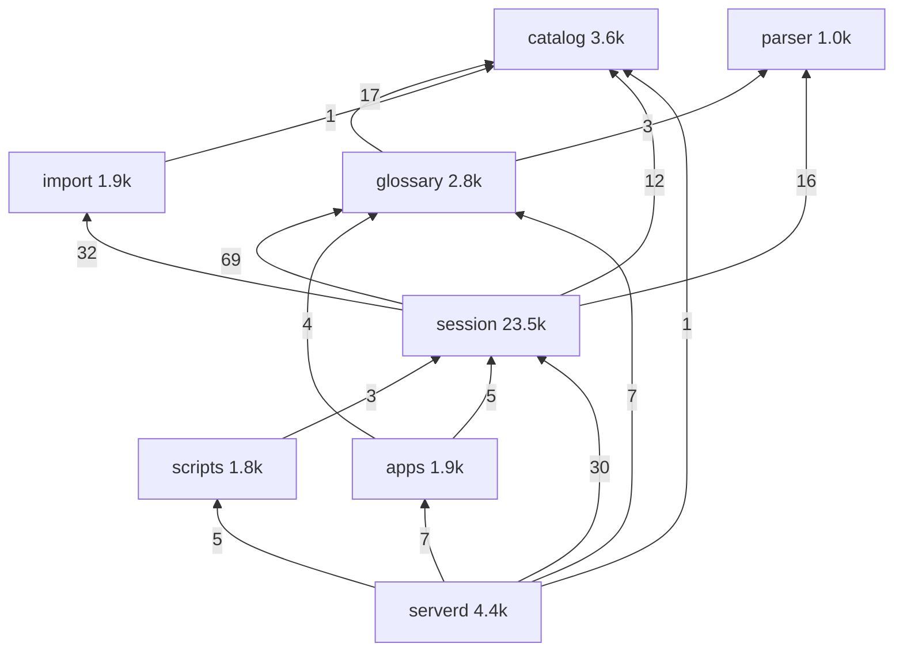
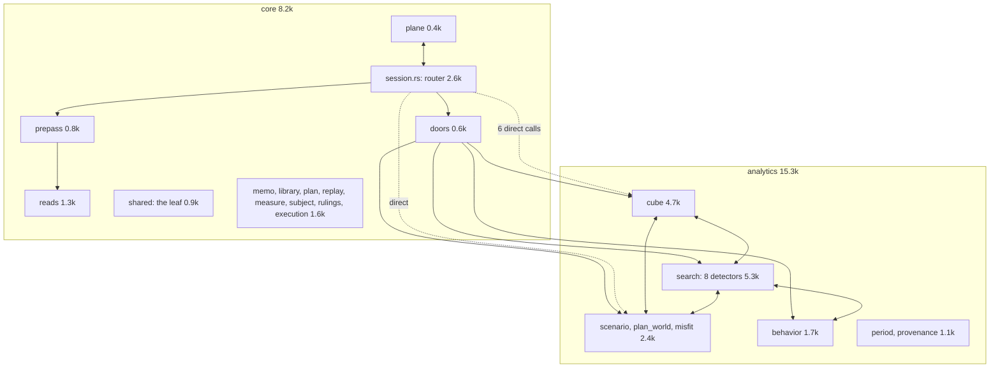
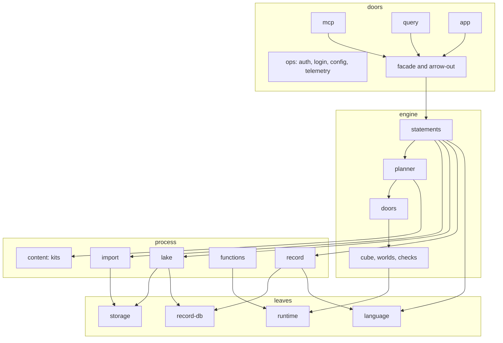
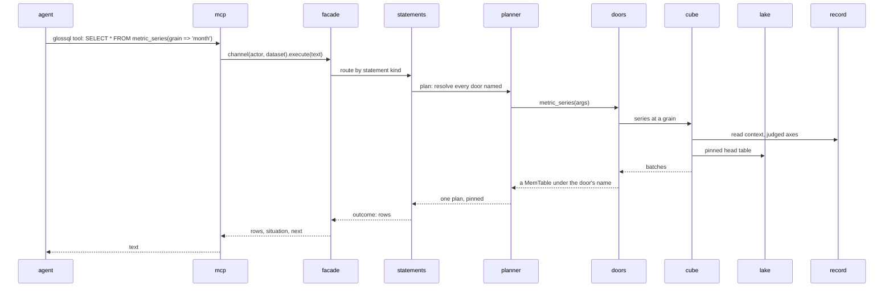
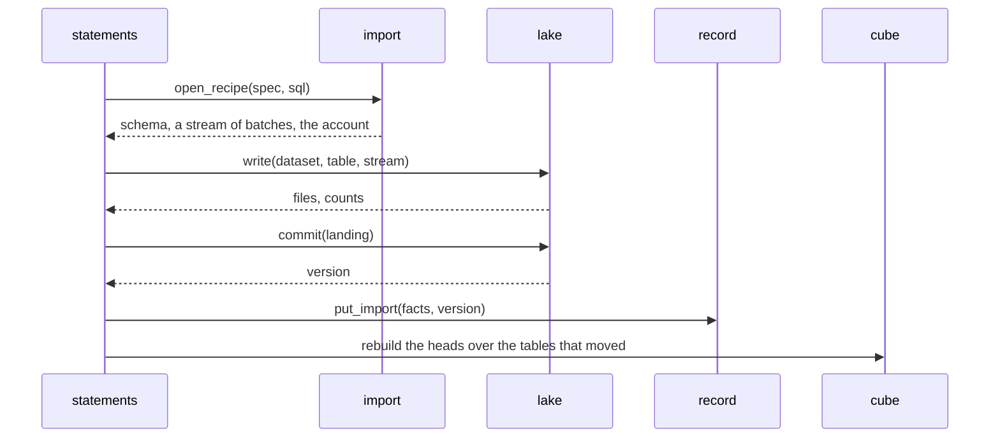
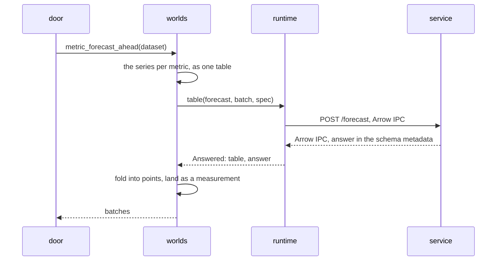
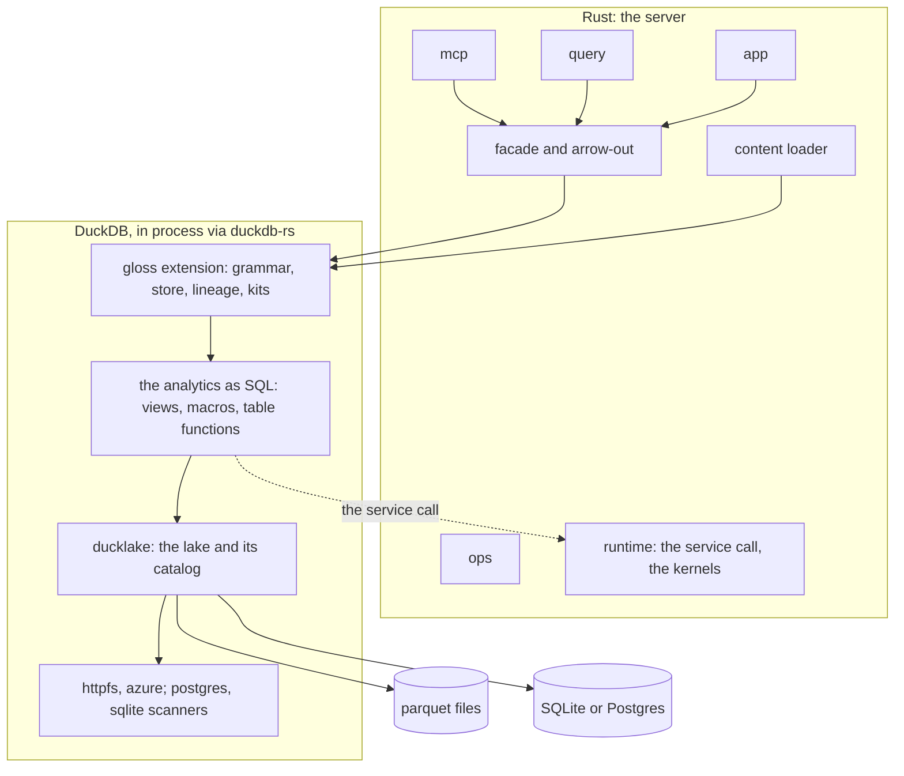
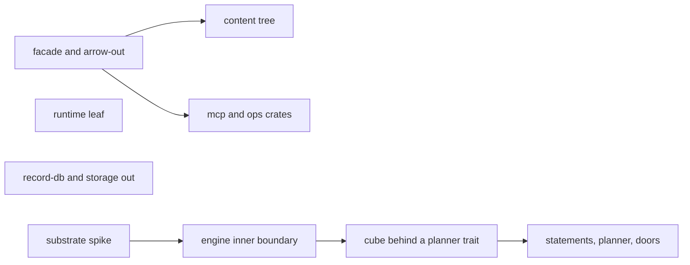

# The server's modules: a design

The design behind `modules.md`. That file is the plan: the rows, the
order, the decisions. This one is the picture: what the server is
today, what its code is made of, what it should become, and the two
engines it could become it on.

The constraint that does not move: one binary in one image. MCP, the
app, the query door, import and export run in one process, and the
same process runs as a batch job. What this design changes is inside.

## 1. What the server is



The engine reads two stores and one kind of service. The lake holds
the rows a recipe landed, as parquet files under a warehouse, with
their versions in DuckLake-shaped tables. The record holds what the
rows mean: declarations, glosses, measurements, rulings. A service
turns rows into rows over HTTP and never writes.

## 2. The crates today



Numbers on nodes are source lines; numbers on edges are `use` sites.
The graph has no cycle. One edge points against the process: scripts
implements a trait that session declares, and serverd injects it.

| Crate | Source lines | Tests | Suite time | Build, measured |
|---|---|---|---|---|
| parser | 992 | 48 | 0.03 s | 30 s |
| glossary | 2,775 | 48 | 0.7 s | 6 min |
| catalog | 3,553 | 14 | 2.0 s | 5 min |
| import | 1,924 | 14 | 0.1 s | 3 min |
| session | 23,462 | 160 | 12.9 s | 4 min |
| scripts | 1,752 | 70 | 4.8 s | 2 min |
| apps | 1,942 | 38 | 5.4 s | 5 min |
| serverd | 4,365 | 79 | 17.5 s | 5 min |

The suites are fast. The builds are not; the times above were taken
with several builds contending for one target directory, so they are
upper bounds. Every crate above the parser compiles DataFusion,
because the catalog carries both the lake and the record's database,
and the glossary needs the catalog for a pool and three existence
checks. The release binary is 176 MB over
499 crates. DataFusion brings 101 of those crates alone, faer 39,
jsonwebtoken 26, jsonschema 23, sqlx 19, the OTLP export 14, rmcp 13,
ADBC 11.

### Inside the session crate



Two things stand out. The analytics are two thirds of the crate.
And five of the seven two-way edges the conformance suite tolerates
sit inside them. Each of those five is a record read both sides want,
or the world switch that sits inside the cube's series read instead
of in the doors. The six dotted calls are the router reaching into
the analytics around the doors.

### The content

The server ships text that is not Rust: the vocabulary and the
function bodies, the reads, the docket's pages and frames, the
skills, the docs. It is embedded through six hand-kept Rust lists and
one build script.

| List | Where | Files |
|---|---|---|
| function bodies, the kit, the witnesses | `scripts/src/library.rs` | 18 |
| shipped reads, `next.sql` among them | `session/src/library.rs` | 9 |
| the docket | `apps/src/builtin.rs` | 65 |
| templates, assets | `apps/src/pages.rs`, `assets.rs` | 21 |
| skills, SPEC, grammar | `serverd/src/skills.rs` | 6 |
| references, docs, vendor | `serverd/build.rs` | generated |

## 3. What the session's code is made of

The question was why 23.5k lines. Comments are 11 percent and the
in-file tests 900 lines, so neither is the answer. By feature:

| Feature | Lines | Share |
|---|---|---|
| the cube: head, grains, verbs, judged axes, key, cache, four reads | 4,735 | 20% |
| the worlds: scenario, plan, forecast, bands, misfit | 4,455 | 19% |
| the detectors: relationships, hierarchies, derivations, coherence, collisions, facts | 3,220 | 14% |
| the behavior door | 1,715 | 7% |
| lineage and the calendar: provenance, period | 1,142 | 5% |
| the statement router | 2,626 | 11% |
| the planner: pre-pass, reads, memo, library, replay, measure, subject | 3,370 | 14% |
| the leaf, the plane, the doors, execution, rulings | 2,199 | 10% |

By kind, over every function outside tests (20,262 lines), classed
by what its signature takes and returns:

| Kind | Analytics | Core | All |
|---|---|---|---|
| shaping batches: arrays in, a `RecordBatch` out, column by column | 3,759 (28%) | 678 | 4,437 (22%) |
| building plans: `LogicalPlan`, `Expr`, SQL text in `format!` | 2,653 (20%) | 1,206 | 3,859 (19%) |
| refusing and validating arguments and bodies | 1,298 (10%) | 298 | 1,596 (8%) |
| reading the record as JSON, field by field | 1,004 (7%) | 0 | 1,004 (5%) |
| the rest: dispatch, statistics, admission, the router's arms | 4,823 (35%) | 4,543 | 9,366 (46%) |

So in the analytics, two thirds of the lines sit in functions whose
job is to carry data between the record's JSON, the engine's plans
and Arrow's arrays. Every door is the same pipeline written again:
parse the arguments, read the record, build a plan, run it, fold the
rows in Rust, build an output batch. The largest functions are those
folds and builders: `metric_forecast_ahead` 235 lines,
`derivation_candidates` 220, `misfit_batch` 207,
`hierarchy_candidates` 187. The cube adds a hand-written OLAP layer
on top: its key digest and cache, the admission of axes and time, the
head landing, two stages of planning, derived plans over cells.

### What that implies

The glue exists because DataFusion is a library for building an
engine, not a database. It has no views a statement can name, no
macros, no session variables, no catalog of its own, no snapshots.
The server built each of those: the pre-pass resolves doors ahead of
planning because the planner cannot; the record is read as JSON
because there are no typed relations to query; the cube lands its own
head and caches its own grains because nothing else versions a derived
table. The substrate skill's rules, the zero-greps and the ratchet,
are the record of that cost.

A host that serves views, macros, typed relations, variables and
snapshots takes most of that work. A measurement is a macro any SQL
calls. A grounding is a view. The store's relations are typed views
the doors query. A door is a table function whose body is SQL. The
worlds are SQL over the head and the service's answer table. What
remains in a programming language is what SQL cannot do: the service
call, the statistical kernels, the grammar's transforms, the doors
themselves.

The implication for this design: the analytics should be content, not
code, wherever the host allows it. That is true on either engine. On
DataFusion it means more shipped `.sql` and less Rust per door, which
the shipped reads already show. On DuckDB with the extension beside
this repo it is the extension's design already: `gloss_kit` loads
SQL, a measurement is a table macro, a grounding a view, the relations
are `ws.glossql.*`.

## 4. The target



Every edge points down. Nothing in a layer reads a layer above it,
and nothing in a leaf names the engine.

### The modules and their seams

**language** (today `parser`). Parses glossql on the engine's parser
and hands every other statement through as substrate SQL.

```rust
fn parse_sql(text: &str) -> Result<Vec<Statement>>
```

**record-db** (today `catalog/record.rs`). The record's tables on
SQLite or Postgres: text, binds, rows, two transaction shapes, the
dialect switch. sqlx stays behind it as its one module.

```rust
trait RecordDb {
    async fn fetch(&self, sql: &str, binds: &[Bind]) -> Result<Vec<Row>>;
    async fn execute(&self, sql: &str, binds: &[Bind]) -> Result<u64>;
    async fn transaction(&self) -> Result<Tx>;   // begin; commit on drop or explicit
    fn is_sqlite(&self) -> bool;
}
```

**storage** (today `catalog/storage.rs`). A location to an object
store and a URL: local, S3, Azure, GCS, configured by the environment.

```rust
fn open(location: &str) -> Result<(Arc<dyn ObjectStore>, Url)>
```

**runtime** (today `session/shared.rs:260-389`). The service seam
and the native kernels' registration, plus the Arrow IPC wire the
services and the doors share.

```rust
trait FunctionRuntime {
    fn serves(&self, point: &str) -> bool;
    async fn table(&self, point: &str, table: RecordBatch, spec: Value) -> Result<Answered>;
    fn reconcile(&self, aligned: &[RecordBatch], n_common: i64, terms: &[String]) -> Result<Value>;
    fn udafs(&self) -> Vec<AggregateUDF>;
}
```

**record** (today `glossary`). Declarations, glosses, measurements,
the collapse, the rules. Opens on a `RecordDb`, not on the lake; the
three existence checks and the `Lake` holder move to the engine. Its
reads are pure over `ReadContext` already, so they test without a
database.

```rust
impl Store {
    async fn open(db: Arc<dyn RecordDb>) -> Result<Store>;
    async fn read_context(&self, scope: Scope) -> Result<ReadContext>;
    fn collapsed_read(rctx: &ReadContext, subject: &Subject) -> Vec<CollapsedRow>;
    async fn gloss(&self, actor: &Actor, aspect: &str, subject: &Subject, body: &JsonBody) -> Result<()>;
    async fn measurement_put(&self, row: MeasurementRow) -> Result<()>;
}
```

**lake** (today `catalog` minus the two leaves). The DuckLake tables,
the pin, the mount, the views, the parquet write. Lands tables and
serves them as providers at a version.

```rust
impl Lake {
    async fn write(&self, dataset: &str, table: &str, rows: Stream) -> Result<Landed>;
    async fn commit(&self, landing: Landing) -> Result<Version>;
    async fn pin_dataset(&self, dataset: &str) -> Result<Vec<PinnedTable>>;
    fn mount(&self) -> Arc<Mount>;   // a CatalogProvider over the pinned rows
    async fn put_view(&self, dataset: &str, name: &str, sql: &str, schema: &Schema) -> Result<()>;
}
```

**import** (today `import`). A recipe at a source to a typed stream
with its account. Takes its store client from storage, so it no
longer links the lake. The try-casts, the reader listing and the
local-path policy go to the planner, where they act.

```rust
async fn open_recipe(spec: &SourceSpec, sql: &str, env: &RuntimeEnv) -> Result<Recipe>
struct Recipe { schema: SchemaRef, rows: Stream, account: Account, exprs: Derivations }
```

**functions** (today `scripts`). Two modules: the kernels (faer and
arrow, no HTTP) and the services (reqwest and IPC, no math).
`KernelRuntime` composes them and implements the runtime seam.

**content** (today six lists). One `kits/` tree, one loader below
the engine, one validation suite: every body splices, every read
parses, every frame plans, every skill is on disk. The kits plan
holds the folder shape.

**statements, planner, doors** (today `session`). The engine's three
parts share `Shared`, the leaf: the refusal, the outcome, the state a
channel holds, the resolution a statement carries. Statements routes
by variant and owns declaring, landing and glossing. The planner
resolves every door a statement names before planning, then plans
once. The doors are the only road into the analytics.

```rust
// statements
async fn execute(&self, text: &str) -> Result<Vec<Outcome>>
// planner
async fn plan(shared: &Shared, ctx: &SessionContext, stmt: Statement) -> Result<Planned>
// doors
const DOORS: &[(&str, &str)];
async fn compute(shared: &Shared, resolved: &Resolved, door: &str, args: &Args) -> Result<Served>
```

**cube, worlds, checks** (today the analytics). Behind the doors.
They reach the planner through one trait, so the cube can live below
the doors without re-entering the router.

```rust
trait Planner {
    async fn build_plan(&self, sql: &str, pins: &Pins) -> Result<LogicalPlan>;
}
```

**facade and arrow-out** (today `Plane`, `Session`, three encoders).
The one contract every door uses, and one encoder for IPC, CSV,
Parquet and JSON. Engine types stop here.

```rust
impl Plane {
    async fn channel(&self, actor: Actor, dataset: Option<&str>) -> Result<Session>;
    async fn datasets(&self) -> Result<Vec<String>>;
    fn pages(&self) -> &[DoorPage];
}
impl Session {
    async fn execute(&self, text: &str) -> Result<Vec<Outcome>>;
    async fn stream(&self, sql: &str, params: &HashMap<String, String>) -> Result<RowStream>;
}
```

**mcp, query, app, ops, serverd.** The three doors over the facade.
Ops verifies who knocks and reads the process's settings; it reads
`Actor` and `Caller` from the record and nothing else of the domain.
Serverd is `main.rs` and the router: the composition root.

### Three flows

A statement from an agent:



A landing:



A service call:



## 5. The two engines

The design above holds on DataFusion as it stands. The engine beside
this repo is the other option: DuckDB 2.0 with the gloss extension,
the server talking to it through `duckdb-neo`, the Rust crate on
DuckDB's v2 C API. DuckDB 2.0's grammar extension API, the PEG
parser an extension adds rules to, is what makes the language
implementable inside DuckDB; the extension is built on it, for
v2.0.0, and the crate pins the same commit, so the server loads the
extension by path like any installed extension. Three pieces then
make the engine:

- **The C++ extension**: the grammar, the store, lineage, kits. The
  only piece that needs DuckDB's C++ API, built per DuckDB version
  and platform, unsigned, carried in the image.
- **The server's own functions**: `duckdb-neo` registers scalar,
  aggregate and table functions on the database from the host
  program, no extension file needed. The kernels (the profile
  aggregate, reconcile) and the service-backed doors (forecast,
  misfit, whatif, each a table function that posts Arrow and returns
  the answer) stay Rust in the server, as do any detectors that
  outgrow SQL.
- **SQL in the kit**: the analytics as views, macros and table
  macros over the head table, the store's typed relations and the
  answer tables, loaded by `gloss_kit`.

`ducklake`, `httpfs` and the cloud extensions are DuckDB's own,
installed into the image at build time.



What each module becomes:

| Module | On DataFusion | On DuckDB with gloss |
|---|---|---|
| language | the parser crate | the extension's grammar rules, C++ |
| record-db, record | a trait with sqlx; the store | the store in the DuckLake catalog, typed views `ws.glossql.*` |
| storage, lake | object_store; the DuckLake tables written by hand | httpfs and azure; the ducklake extension |
| import | the engine's readers in a scratch context; ADBC | `read_csv`, `read_parquet`; attached databases |
| statements, planner | the router; the pre-pass and the relation planner | the grammar's transforms; the binder |
| doors | a closed match in Rust | table functions, SQL bodies |
| cube, worlds, checks | 15k lines of Rust | SQL over the head table and the answer tables; kernels in Rust |
| runtime, functions | unchanged | unchanged, called from a table function or the facade |
| facade, arrow-out | over `Plane` | over a `duckdb-rs` connection, Arrow out |
| mcp, query, app, ops | unchanged | unchanged |
| content | `kits/` | `kits/`, loaded by `gloss_kit` |

What the extension holds today: SPEC §3 to §8, the store in the lake's
catalog, lineage off the bound plan, kits, 977 assertions over nine
suites, 4.0k lines of C++. It has no cube, no worlds, no doors. Its
own research note names the analytics as the port cost.

What the move buys: a bundled `duckdb-rs` resolves 64 crates where the
server resolves 499; DataFusion, object_store, parquet, sqlx and ADBC
leave the tree. The catalog's 1.6k lines of DuckLake DDL, the import
crate's reader context, the planner's pre-pass and relation planner
and most of the analytics' glue are the host's. The doors, ops and the
content tree carry over.

What it costs: two languages in the product, since the grammar API is
C++ only, labelled preview, and the extension builds per DuckDB
version and platform; the analytics rewritten as SQL, which is the
part with the semantics; DuckDB's own rules in place of the substrate
skill, one writer per database among them, which fits one user per
container; a synchronous driver, so the doors call it on the blocking
pool; `duckdb-neo` itself, which its README calls unstable, on a C
API "in rapid development", with static linking of Rust extensions
still marked to be done; the image carries the extension files beside
the binary.

What decides it: one door and one detector built both ways and
measured. The plan's first row, built in `../gloss-neo-spike`:

| | The server today | The spike |
|---|---|---|
| the series read | 377 lines in its named functions, 1,046 for the head | 32 lines of SQL, no Rust: one macro over the grounding's view, loaded as a kit |
| the hierarchy detector | 502 lines | 69 lines, one generated statement |
| the kernel | 55 lines | 55 verbatim, 40 to register from the host |
| crates | 499 | 70 with arrow-rs for the Arrow door, 30 without |
| clean release build | minutes per crate | seconds, the library prebuilt |
| the scenario | — | 620 ms end to end |

Left out of the spike, and so not measured: the judged axes from
measurement verdicts, the worlds and the service call, the ratio verb,
the cache, the server's shaped refusals. What it settled: the series
door is kit content once a grounding serves `period` and `value` by
convention; a function registered through the C API cannot run SQL
from its callbacks, so a Rust function is pure over its inputs and
whatever reads the catalog is SQL; the Arrow C stream out of the
engine reads into arrow-rs with nothing copied on the Rust side.

## 6. The order



The spike decides the engine. The four rows on the left hold on
either engine and run beside it. The three rows on the right are the
DataFusion path and wait for the verdict; on the other path their
work is SQL in the extension's kit instead.

Risk, effort and touch points per row: `modules.md`.

## 7. The port, if ruled

What moving the server onto DuckDB with the extension costs, by area,
in working days for one person. The rates come from the spike: a door
or a detector that is SQL over the record takes half a day to a day
with its test; a world that needs a service, two to four.

| Area | What happens | Days |
|---|---|---|
| the facade and the three doors on `duckdb-neo` | `channel`, `execute`, `stream` over one connection per call, the actor as a session variable, the row cap, the brief as SQL; mcp, query, app and ops unchanged above it | 3–5 |
| kits | the KPI kit, the fifteen bodies and the witnesses into the extension's kit form; the nine shipped reads and `next.sql`; the docket's 52 frames, each re-run under DuckDB's SQL | 7–10 |
| the cube's reads | `metric_series` done; `metric_axes`, `fact_values`, `metric_sources` as SQL over the record and `gloss_lineage` | 2–3 |
| the detectors | relationships, derivations, coherence, collisions, facts as generated SQL, hierarchies done | 3–5 |
| the behavior door | the probes as SQL, the reconcile kernel registered, the election in Rust over its inputs | 2–3 |
| the worlds | plan as a declared table and a tie, 1–2; forecast and bands through the service from the host, 3–4; misfit, 1–2; the scenario's replay with overrides, which rewrites a bound plan and has no SQL form yet, 5–8 in the extension's C++ or as a ruled SQL form | 10–16 |
| kernels and services | the aggregates through neo's builders, `remote.rs` carried over, the answer landed as a measurement | 1–2 |
| import | the cast accounting and the local-path policy the extension softens; ADBC kept for sources DuckDB has no scanner for | 2–3 |
| the image and the release | DuckDB bundled, the extension's Linux build and the lake extensions in the image, CI fetching the extension from its repository | 2–3 |
| acceptance | the doors, next and apps suites ported, the cube internals' tests retired, the docs and skills harness, one glossval run | 6–9 |
| docs and skills | the engine's SQL guide swapped, the language of the reads where names move | 2–3 |

About 40 to 60 days. The substrate-independent rows of the plan (the
runtime leaf, record-db and storage out, the facade, the kits tree)
are inside that number, not beside it: done first, they shrink the
cut. Three risks carry most of the spread: the scenario replay, the
one piece with no SQL shape; behaviour parity on the next read and
the question round, which only the eval settles; and the extension's
own base, a preview C++ API built per DuckDB version.

The days above are an extrapolation from one spike and the line
counts, not a measurement. The way to make them one is steps, each
building the new path beside the old and measured at a gate, with
nothing in the old crates touched before the last step: the old code
is deleted at the cut-over, never refactored.

| Step | Builds | Gate |
|---|---|---|
| 1 | the three doors on neo over the extension's record and lake: declarations, glosses, recipes, `GLOSSARY()`, `ATTEST()`, measurements, the brief, the question round; no analytics. Built: `crates/duck` behind the `duck` feature of `serverd` and `apps` (1,287 lines of Rust, 139 of SQL), the record's derived reads in its `core.sql` | the door suites that do not name a cube read, counted first; the docs and skills harness. Passed: 46 serverd and 11 apps door tests green on DuckDB, 48 marked session-only by reason (the plan) |
| 2 | the vocabulary and the quality kits as SQL with `.test` suites: the words, the profilers, the structure detectors. Done on the extension's `kit-quality` branch: `kits/quality/kit.sql` holds the five screens as table macros over one new bind-time function, `dataset_cells(subject[, views])`, the five measurements over them, and the temporal profile; about 600 lines of SQL and 110 of C++ against 3,220 of Rust and the shipped bodies; its suite holds the server's fixtures. The words and the two column profilers were the KPI kit's already | the scripts suite's cases, rewritten as `.test` files |
| 3 | the metrics kit: the grounding schema, the four reads, the metrics and slices goals, the metrics pages | the next read's metrics and slices goals; one glossval run |
| 4 | the futures kit with the service calls from the host; the replay deferred | the forecast, bands and misfit cases; the eval |
| 5 | the image, the release, the docs; the old crates deleted | the whole suite and the eval, green |

Step 1 passed its gate; the plan's three engine rows on DataFusion
are dropped, not done.

### 7.1 The metrics structure, ruled

The temporal behaviour of a metric, as the metrics kit builds it. Seven
rules; what each replaces is the cube's serve-and-mark (section 3).

1. A metric is a view, and the view's columns are subjects, glossed and
   measured like a table's.
2. The view's period column carries `role = timestamp` and gets its own
   profile; the view's value column carries `role = measure` and its
   `behavior`: stock, flow, or ratio with its halves named.
3. The ladder — floor, windows, calendar — is a fact on a time column,
   owed where the role is timestamp, with the measured cadence as the
   floor's default. The dataset-level `cube` fact goes.
4. A metric's temporal behaviour is its value column's collapsed
   behaviour slot, at its period column's cadence, under that column's
   ladder.
5. A table's columns keep their roles, profiles and behaviour: what the
   agent reads to write the grounding's aggregation, and what a detector
   reads through lineage to propose the view's roles.
6. The reads are SQL over the collapsed slots and the view. Nothing is
   re-marked at read time; a verdict older than its data is stale by the
   record's own rule, and the read says so.
7. The extension admits view columns as subjects: one generic change.

The no-claim rule: at the period column's own cadence nothing is
combined and no behaviour is needed; at a coarser grain, with no
behaviour claim on the value column, the read refuses and names the
act — no behaviour stands on `spend.value`, the evidence says flow at
0.9, gloss it. A silent default is wrong for a stock and teaches the
agent nothing; a refusal is what `next` routes.

Why the view's columns and not keys in the grounding body: a ruling
then lands on one fact instead of the whole grounding; the behaviour
has a slot the witness can band and `ATTEST` can serve; the metric's
own period has a subject for its profile, which a filtered or joined
grounding needs; a derived period has a column for its ladder; and a
metric used as another grounding's source is a table with a table's
facts. Measured on 2026-10-31: the profile runs on a table column on
the extension; a view's column is not yet admitted as a subject.

## 8. For the long run

Four directions the lead set, held here as design, not as rows.

**Functions, separated sharply.** At its core the server runs SQL
with functions on top of imported data in a catalog, with a glossary.
Today a function is one of four things with four shapes: a shipped
SQL body spliced into a declaration; a Rust kernel registered as an
aggregate; a service behind the runtime seam's table call; a door, a
closed arm in the engine's match. In essence each is called from
within a SQL statement. The direction: one function plane with one
shape — a name, a signature, a kind of body (SQL, native, service) —
registered through one registry, declared by a kit, with the core
knowing only how to call a function from SQL and how to record its
result. The doors become functions too; their shapes are declared in
`DOORS` already. What this cuts: the per-door pipelines of section 3,
the six content lists, the special path for detectors. What stays in
the core: the catalog, the record, admission, the pin and the
measurement rule.

The work, on DuckDB: the kits tree (3–4 days, the kits plan), the
native functions through one registration module (1–2), the service
contract declared once in the kit as the spec and answer aspects per
point (2–3), the listing pages as a query over the engine's own
function catalog (1). About two weeks, and most of it is the kits row
of the port above. On DataFusion the same tree and loader land, but
the doors stay a closed match in Rust and the registry is the
engine's registration code: about three weeks.

**The cube as a view and a cache.** The cube holds three things: an
admission rule (which column is time, which columns are axes, read
from the record's measurements), the verbs (sum, last, average, read
from the behavior gloss), and a materialized head with grains derived
over it. The first two are SQL over the record. The third is a cache
policy. In a host with views, `metric_head(m)` is a view generated
from the record — the grounding grouped by the bucketed time column
and the admitted axes, aggregated by the verb — and
`metric_series(m, grain)` is a macro over it. Whether the head is
materialized is then a measured question per read, settled by the
landing hook, not a layer of its own. The code that remains is the
generator that reads the record and writes the view's SQL.

**Worlds as functions with a world column.** A world is a `status` on
the series shape. Actual is the head. Plan is a declared table.
Forecast is a function's answer. Scenario is the grounding replayed
with overrides, which a host with variables expresses as a
parameterised view, plus the service for what no definition reaches.
The series read unions them. No world needs machinery beyond its
function and the shape.

**Axes as a record read and distinct values.** Which columns are axes
is a read over the measurements, the relevance verdicts. Their
members are `SELECT DISTINCT` over the head at the pin. Both are
views; the second is cheap to cache by pin. An axis is then a filter
and a group on a view, not a structure the cube owns. The spike went
one step further: with a kit convention that a grounding serves
`period` and `value`, every other served column is an axis and no
admission is needed for the read. Whether the time column is declared
by the convention or judged by a verdict is a language question for
the corpus.

**What must persist.** A measurement row is the record, not a cache:
it carries the pin, the reads, the actor, and a service's name and
version, and a ruling may stand on it. That stays for anything a
human may rule on and for every service answer, which cost a call and
may not repeat. A derived read over persisted rows — band points,
coverage, the walk's shape — is a view by pin and need not land. The
rule: persist judgments and service answers; derive and cache the
rest; key every cache by the pin and the function's inputs, as
`measurement_stands` keys today.

## 9. What the port retires, and where the functions live

**Plan and AST walks today.** Seventeen files walk or rewrite the
engine's plans and SQL ASTs, about 190 sites. By what each becomes:
`provenance.rs` (700 lines, 67 sites) is the extension's
`gloss_lineage`; the cube's plan builders and the detectors' plans
are SQL; the pre-pass, `reads.rs`, `measure.rs` and `subject.rs` are
the binder and `$subject`; import's `derivations` is the extension's
lineage per landing and its cast accounting is `TRY_CAST` with a
count the recipe can carry; `replay.rs` (444 lines, the override
projection over every scan of a table) is the one walk with no SQL
form: a `gloss_replay(sql, overrides)` in the extension's C++, which
already walks bound plans, about 300 lines.

**Lines, by fate** (an estimate from the crate sizes; step 1 above
measures the first of it). Rust source today is 41k. Kept and moved
onto neo: the doors and ops (about 5,600), the facade (about 500,
new), the kernels and the service client (about 1,100), the pure
halves of the worlds and the behavior door (about 600). ADBC is
optional: DuckDB reads Postgres, MySQL and SQLite through its own
scanners, and only a source with no scanner needs the ADBC path, which
is then a table function `adbc_query(driver, uri, sql)` registered
from the host, so a recipe runs at the source inside the extension's
`IMPORT` unchanged. About 8,000 stay; about 33,000 retire.
SQL grows from about 5,000 lines carried over (bodies, reads, frames,
re-run under DuckDB) by 1,500 to 2,000 for the doors, the detectors
and the worlds. The extension's 4,000 lines of C++ are shared with
its own repository. Of 34k lines of tests, about half retire with the
store, the catalog, import and the cube's internals; the kits gain
tests in DuckDB's own `.test` format and run without the server.

**The worlds** (4,455 lines) are alpha and may change on client
contact, so they become one kit of their own and part of them moves
to the service they wrap. Per world: forecast shapes the series in
SQL, calls from the host, folds points and coverage in SQL over the
answer; bands sends the whole series once and lets the service walk
the origins, which it computes anyway; misfit is a frame, a call and
a score column; plan is a declared table and a tie; scenario is its
levers and checks as kit aspects, its service pass from the host, and
its exact replay waiting on `gloss_replay`. Semantics stay in the
core; what moves to the service is the walk and the folds it already
computes.

**The kits**, cut by what the content is about, each a directory the
loader runs in file order with its own `.test` suite. The placement
below is checked against today's lists: the twenty aspects of
`kpi_kit.glossql`, the thirteen measurement aspects and fifteen
functions of `bootstrap.glossql`, the eight witnesses, the nine
shipped reads and the 52 frames.

| Kit | Holds | Depends on |
|---|---|---|
| the core, not a kit | the extension; the record's own reads (`owed`, `open_questions`, `ruling_entries`, `agent_assumptions`, `workspace_next`), the `ruling` and `recipe_change` aspects, the rulings and structure goals, the docket's shell, glossary, export and query pages, the `app*` aspects | — |
| `vocabulary` | what things mean: `meaning`, `role`, `behavior`, `unit`, `dimension`, `entity`, `conventions`, `formulas`, `definitions`; the eight witnesses; `slot_entropy`; the glossary skill | the core |
| `quality` | what the data is like and how it holds together: `profile`, `outliers`, `temporal` and their aspects; `detect_relationships`, `detect_hierarchies`, `detect_derivations`, `relationship_coherence` and theirs; `rate_tolerance`; the checks goal; the quality and lineage pages | `vocabulary` |
| `metrics` | measures over time: the grounding schema, `cube`, `behavior_evidence`, `dimension_relevance`, `detect_grounding_collisions`; the four reads and `metric_surfaces`; the metrics and slices goals; the metrics pages; the metrics skill | `vocabulary`, `quality` |
| `futures` | the worlds: `lever`, `metric_bands`, `band_breach`, `metric_forecast`, the plan and scenario ties, the points' spec and answer aspects; their reads; the bands and plan goals; the corridor pages; the forecast and scenario references | `metrics`, a service per point |
| `harmonisation` | the demo kit of the kits plan | `vocabulary` |

The kernel plan's line that planning is "the KPI kit with futures,
not a second pack" is the lead's to update with this cut.

```
kits/<name>/
  NN-<part>.sql        declarations and macros, loaded in order by gloss_kit
  goals/<goal>.sql     the next read's arms, assembled into one macro by the loader
  apps/<app>/          app.toml, pages, frames/*.sql, specs/*.json
  SKILL.md, references/
  tests/*.test         DuckDB sqllogictests over a scratch lake
```

Where a function lives follows its kind. A SQL body is a kit's: a
measurement or detector as `DECLARE FUNCTION`, held in the record's
`functions` relation; a read or a door as `CREATE MACRO`, held in the
lake's catalog. A native lives in the server, `crates/functions`,
registered at boot and named by the kit that calls it; a test holds
every name a kit calls to a registered function. A service lives in
its own repository and is named per point by the deployment. The core
is the extension and the server's doors; it ships no vocabulary.

## 10. Lance, as the lake

The lead's third option: the Lance format and its Rust library as the
lake and the record's store, with the catalog a directory on the blob
store. Facts, read on 2026-10-31 from `lance.org` and the crates.

- **The format.** A table is a directory with a manifest per version
  under `_versions/`; every commit is a version, time travel is a
  checkout. Tags are named references under `_refs/tags`. Branches
  are "multiple independent version histories", each "technically a
  shallow clone of the source dataset", with its own chain under
  `tree/<branch>/`; the spec names no merge. Schema evolution adds a
  column by writing new files. Indexes are part of the spec: vector,
  BM25 full-text, scalar. A JSON column type is stored as JSONB with
  JSONPath evaluation (`lance-jsonb`). Keyed upserts are
  `merge_insert`.
- **The catalog.** The directory catalog's v2 is a `__manifest` Lance
  table holding namespaces, tables and, when enabled, table versions.
  It "requires no external metadata service": a blob store is the
  whole backend. It records no atomic commit across tables.
- **The library.** `lance` embeds DataFusion for its scans and offers
  `Dataset::sql(...)`, DataFusion SQL over one dataset, and table
  providers for a DataFusion context. It is a format and a library,
  not a database: no views, macros or variables of its own. `lance`
  14.0.2 pins DataFusion 54 and arrow 58, one behind the server;
  15.0.0-beta.7 pins DataFusion 55, arrow 59.2 and object_store
  0.14.2, in step with the server. Trimmed to the three clouds, lance
  resolves 487 crates on its own: DataFusion, which the server has,
  plus a second storage stack (opendal beside object_store, two
  object_store and two reqwest versions), the AWS SDK and a cache.
  The server's DataFusion and arrow pins would then follow lance's.

Against the pains that raised it:

| Pain | Lance under DataFusion | DuckDB with the extension |
|---|---|---|
| the catalog database, DuckLake "for versioning only" | gone: versions, tags and history are the format's; the catalog is a table on the blob store | stays: DuckLake needs SQLite or Postgres |
| branching and tagging data | native | snapshots only |
| vectors and full text for documents | native, in the spec | the `vss` and `fts` extensions |
| JSON in SQL | a JSON column type and JSONPath in the scan; SQL functions over it to be checked | DuckDB's own, which the lead rates strong |
| the analytics glue of section 3 | unchanged: DataFusion has no views, macros, variables, `COLUMNS` or `UNPIVOT`, so a door is SQL the host generates plus Rust at the seam | SQL in a kit, as the spike showed |
| languages in the product | Rust alone | Rust and C++ on a preview API |
| what the server's code loses | the catalog crate and the record's SQL (about 4,000 lines), the pin machinery, the merge SQL; the language and the session stay | the language, the record, the lake and most of the analytics |

They answer different questions. Lance is a lake: it fixes
persistence, history and search, and it keeps the server's code
otherwise as it is. DuckDB is an engine: it fixes the language's home
and the analytics' expressibility, and it keeps a catalog database.

Combining them, checked on 2026-10-31: DuckDB 2.0 ships a core
`lance` extension. It reads a dataset by path (`SELECT * FROM
'out.lance'`, local or `s3://` with a secret), attaches a directory
namespace (`ATTACH 'dir' AS ns (TYPE lance)`) in which `CREATE TABLE
… AS SELECT` writes a dataset, writes with `COPY … TO … (FORMAT lance,
MODE 'append' | 'overwrite')`, and searches with
`lance_vector_search`, `lance_fts` and `lance_hybrid_search`. It
documents no checkout by version, tag or branch, and no `INSERT`,
`UPDATE`, `DELETE` or merge; those stay with the lance crate from the
host, as the dive used them. So a DuckDB server over a Lance lake is
possible on paper: DuckDB for the SQL and the grammar, the core
extension for reads and landings, the lance crate for versions,
branches and keyed merges. Two things decide it and are unverified:
whether DuckDB can read a dataset at a version or on a branch, and
whether the gloss extension's store, which inserts rows into tables
of the lake's catalog, can live in an attached Lance namespace. A
half-day spike answers both.

One hypothesis the dive should test: a scenario as a branch. Pass one
of a scenario today rewrites every scan of the lever's table in the
plan (`replay.rs`). On Lance it is a branch, the lever column updated
by its factors on the branch, and the groundings run on the branch
unchanged. No plan rewrite, and the branch is the scenario's record.

**The dive**, same scale as the engine spike, in its own directory,
on `lance` 15 so the pins match:

1. Land the two CSV recipes through DataFusion into a directory
   catalog: write, a keyed `merge_insert`, versions, a tag.
2. The record as Lance tables: aspects, glossary, measurements
   appended; the collapse as DataFusion SQL over them; the pin as one
   checkout per table.
3. A scenario as a branch, against replay's arithmetic on the same
   data.
4. Passages with an embedding column, a vector index, a query by
   distance: the sources plan's first row.
5. Gloss bodies as a `lance.json` column: what DataFusion SQL can ask
   of it.

Measured: lines, the server's crate tree with lance in place of sqlx,
the parquet writer and the catalog crate, build time, and the pin the
server would follow.

**What the dive measured** (`../gloss-lance-spike`, built on lance
14 since 15 is unpublished; its README holds the detail):

| | The server today | The spike |
|---|---|---|
| the catalog | a database and 1,636 lines of DuckLake tables | a manifest table in the directory, no lines |
| a landing, a re-land, the pin | the parquet write, the merge SQL, the snapshot rows, a query per statement | a write, a `merge_insert`, a checkout: 92 lines |
| the record's store | sqlx and the store's SQL | append-only Lance tables and a SQL collapse: 84 lines |
| a scenario's first pass | the plan rewrite, 444 lines | a branch and one `UPDATE` on it: 6 lines |
| documents and search | not built | an index and a nearest read: 10 lines |
| crates | 465 names | about 537 names with Lance in place of sqlx, local storage; the clouds add opendal and the AWS SDK |
| clean release build, binary | minutes per crate, 176 MB | 4 min 54 s, 190 MB |
| the scenario | — | 220 ms end to end |

Settled: the directory catalog is the whole backend; a scenario as a
branch holds, so the one plan rewrite has a storage form; JSON bodies
answer through `json_extract` over the provider; the pins follow
lance, and its build needs `protoc`. Not solved, as expected: the
analytics glue and the language's home, which are the engine's
questions.

## 11. The session crate: where the simplification is

The lead's reframing: not the dependencies, the code we own. Two
levers: a function library that is content, and a versioning kernel
in which a version is a number per table, a re-land is a merge, a
derived table is versioned like a landed one, and a scenario is a
branch. The table reads the session crate (23,462 lines) by area,
says why each area exists, which lever removes it, and what is left.
The "after" column is an estimate from the two spikes' rates.

| Area | Lines | Why it exists today | Lever | What replaces it | After | Risk |
|---|---|---|---|---|---|---|
| the cube | 4,735 | a materialized head with its own key, cache and invalidation; axes and verbs judged in Rust; grains as plans built in Rust | both | the head a landed table versioned like any other, keyed by its inputs' versions; the four reads as SQL templates filled from the record | about 250 Rust, 150 SQL | medium: the judged axes rewritten as SQL over the record |
| the worlds, `replay.rs` included | 4,455 | the scenario rewrites every scan of a lever's table in the plan; forecast, bands and misfit shape a table, call a service and fold the answer in Rust; plan ties a declared table | both | a scenario as a branch and one `UPDATE`; the service called from the host; the folds as SQL over the landed answer; plan as a table and a tie | about 600 Rust, 400 SQL | medium: the first pass changes form; the eval decides parity |
| the detectors | 3,220 | plans built in Rust with an `unnest` fan-out so one scan screens every pair; outputs shaped column by column | functions | SQL bodies in the library, generated per table where the column list varies | about 300 Rust, 400 SQL | low: hierarchies went 502 → 69 in the engine spike |
| the pin and the landing | about 900 | pins, named pins and read contexts per statement; the mount rebuilt per commit; the landing's write, merge SQL and record row; the memo keyed by store version and pin text; the cube's digest of what it read | versioning | a version number per table, a checkout per read, `merge_insert` for a keyed re-land, a derived table's key its inputs' versions | about 200 | low to medium: the stale rule needs the column history per version |
| the record read as JSON | about 1,000 | bodies read field by field in Rust, verdict keys, grounding keys, settings | typed record | typed reads in SQL over the relations, one view per aspect where a reader needs the keys | about 300 | low |
| the doors | about 900 | `DOORS` a closed match, argument parsing per door, the dispatch into the analytics | functions | a door a function in the registry: a SQL body with bound parameters through the seam the shipped reads already use | about 150 | low to medium: named arguments need the binding `measure.rs` has for `$subject` |
| what stays | about 5,600 | the router for declare, gloss, import and extract; the pre-pass and the relation planner; the leaf; the plane and execution; subjects and rulings | — | unchanged | 5,600 | — |

About 23,500 lines become about 7,500: the function library takes
some 11,000 (the cube's reads, the detectors, the worlds' folds, the
doors), the versioning kernel some 4,500 (the pin machinery, the
cube's key and cache, the replay, the landing), the typed record some
700. Outside the session, the versioning kernel also retires the
catalog's 1,636 lines of DuckLake tables.

None of it needs a new engine. DataFusion's hackability is what makes
the generators cheap: a table provider per checked-out version, the
relation planner for named arguments, the shipped-read seam for SQL
bodies. DuckDB would shorten the SQL (macros, `COLUMNS`) and move the
language; Lance would supply the versioning kernel. The order that
makes life simpler soonest, by risk: the detectors as SQL bodies
(any substrate, today), the doors as functions, then the versioning
kernel once the lake is ruled, then the cube and the worlds on both
levers.

## 12. DataFusion's seams: used as meant, and built beside

The 13,500 lines of section 11's third shape, checked against the
extension points DataFusion's "Extending SQL" guide names and the
types the server's sources use (2026-10-31).

| Seam | Guide's intent | The server | Verdict |
|---|---|---|---|
| `DFParser` wrapped for custom statements | the in-tree pattern for new statements | the parser crate hand-parses the glossql heads and delegates the rest | as meant |
| `RelationPlanner` | custom FROM elements, named arguments | `GLOSSARY()`, `ATTEST()`, the store's relations, the doors by name | as meant; the one seam that made named arguments plannable |
| `CatalogProvider`, `SchemaProvider`, `TableProvider` | the catalog hierarchy | the lake's mount, a provider per pinned table, `ViewTable` for groundings | as meant |
| `ScalarUDFImpl`, `AggregateUDFImpl`, `TableFunctionImpl` | functions | the try-casts, the profile aggregate, the file readers | as meant |
| `SessionStateBuilder`, one `RuntimeEnv` | session and runtime wiring | one runtime per process, a state per statement | as meant |
| `ExprPlanner` | custom operators | unused; `->` comes with `datafusion-functions-json` | fitting, not needed |
| `TypePlanner` | custom types | unused | not needed |
| `FunctionFactory` | `CREATE FUNCTION` with SQL bodies | unused: `DECLARE FUNCTION` is the glossql parser's, and `$subject` is bound by an AST rewrite (`measure.rs`) | fitting, not used |
| `UserDefinedLogicalNode` + `ExecutionPlan` | a custom operation planned and executed lazily | unused: a door is computed in the pre-pass into a `MemTable` and handed to the planner | built beside |
| the async pre-pass, the memo | no seam; DataFusion's own `statement_to_plan` resolves table references first, then plans synchronously | copied: every door resolved ahead, because the planners are synchronous and a door reads the record and calls the runtime | built beside, of necessity |

Most of the seams are used as the guide means them. What was built
beside is the part the guide has no answer for: a planner that is
synchronous while the record and the services are not, and no views,
macros or variables for the record to drive. The pre-pass, the memo
and the doors as eager `MemTable`s are that answer, about 2,500 lines,
and the statement router, about 1,500, is the part no engine seam
covers. That is where the past struggles with the planners sit, and
it is what the DuckDB extension does not have to write, since the
grammar transform plans into a table function and the binder has the
context.

The approach decides the SQL the kits are written in: every body,
read and frame, and the SQL inside the corpus' recipes and
groundings, is in one dialect. On DuckDB that is the dialect with
`COLUMNS`, `UNPIVOT`, macros, `query_table` and the JSON functions the
reads want; on DataFusion it is the dialect plus a generator wherever
the record decides a column list.
