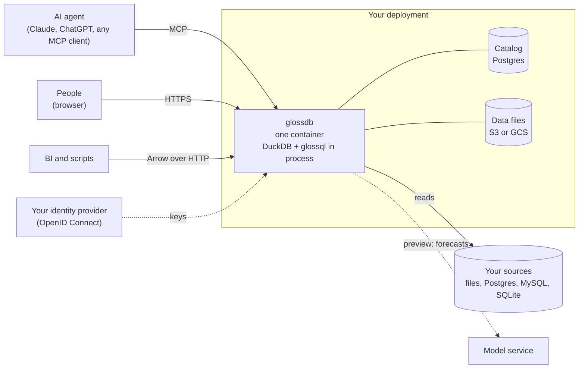

# Evaluate glossdb

For an architect or a security reviewer: what glossdb is, where it
runs, what data goes where, and who may do what. The details are one
link away.

## What it is

glossdb is a harness framework for data agents. It runs beside your
data and gives an AI agent what compilers, tests and CI give a coding
agent: a declared schema of what must be known about the data,
validation on write, measurements and tests on the live data, a review
queue for people, and the next steps after every call. The language it
is written in is [glossql](https://github.com/glossdb/glossql), a
DuckDB extension. How the parts fit: [how the harness
works](../harness.md).

## Architecture

- **One container.** A distroless image, `ghcr.io/glossdb/glossdb`, runs
  as an unprivileged user and listens on 8080. It holds no data and
  reads no file: the platform injects the configuration.
- **The workspace is a DuckLake.** Its catalog lives in Postgres; its
  data files, as Parquet, in an object store (S3 or GCS). Every load is
  a snapshot, and what is known about the data is versioned with it.
  One server owns a workspace.
- **On a laptop** the same binary keeps both in a directory.

Setup and every setting: [install](install.md).

## What data goes where

- **Sources are read, never written.** A load query reads files, an
  object store or an attached database, and writes the result into the
  workspace's lake.
- **What an agent reads leaves through the agent.** Query results and
  catalog rows go back to the MCP client that asked, and from there to
  the client's model provider. Choose the client and its provider as
  you would for any tool that reads your data. A data read ships at
  most 200 rows per call by default (`--row-cap`).
- **The model service sees metric series.** Forecasts, expected ranges
  and scenarios (preview) send a metric's series to the model service
  the deployment names (`GLOSSDB_SERVICE_URL`), hosted or run beside
  the server. Unnamed, those features are off and nothing is sent.
- **Logs carry no statement text.** At the default level a call is
  logged with its actor, dataset, and a digest and length of its text;
  the text itself only at `debug`. Logs go to stdout, and to an
  OpenTelemetry collector only when `OTEL_EXPORTER_OTLP_ENDPOINT` names
  one.
- **Nothing else leaves.** No telemetry is sent to us.

## Sign-in and actors

- glossdb is an OAuth 2.1 resource server. It verifies tokens from your
  OpenID Connect provider against the provider's published keys. It
  issues no tokens and keeps no user table.
- The token's subject is the actor. Every annotation, decision and load
  is stored with who made it and when.
- The interface sets the kind of actor: the MCP interfaces write as an
  agent, the browser and the query endpoint as a person. A person's
  review decision outranks every agent's annotation.
- Engine settings (`SET`, `ATTACH`, `INSTALL`, `LOAD`, `CALL`) are open
  only to the actors `GLOSSDB_ROOT` names.
- Grants per actor on statements and datasets, as in SQL, are planned.

Tokens and the provider setup: [install](install.md#tokens). Clients:
[connect](connect.md).

## Interfaces

| Path | For | Serves |
|---|---|---|
| `/mcp`, `/<dataset>/mcp` | agents | one MCP tool, `glossql`, for glossql and SQL; the skills as resources |
| `/<dataset>/query` | tools | a query in, an Arrow IPC stream out |
| `/<dataset>/app` | people | the console: review queue, metrics, quality, glossary, lineage, export |
| `/healthz` | the platform | a probe, outside sign-in |

## Status

Release 0.3.0.

| Feature | Status |
|---|---|
| The catalog, annotations, measurements, tests | stable |
| The `kpi` and `quality` kits | stable |
| The MCP server, goals and next steps | stable |
| The semantic layer: metrics, series, slices | stable |
| The review queue and the console | stable |
| Data apps, Arrow over HTTP, export | stable |
| Sign-in through an identity provider | stable |
| Forecasts, expected ranges, plans, scenarios (through a model service) | preview |
| Grants per actor on statements and datasets | planned |

## License

glossdb is Apache 2.0. The glossql extension is MIT.
